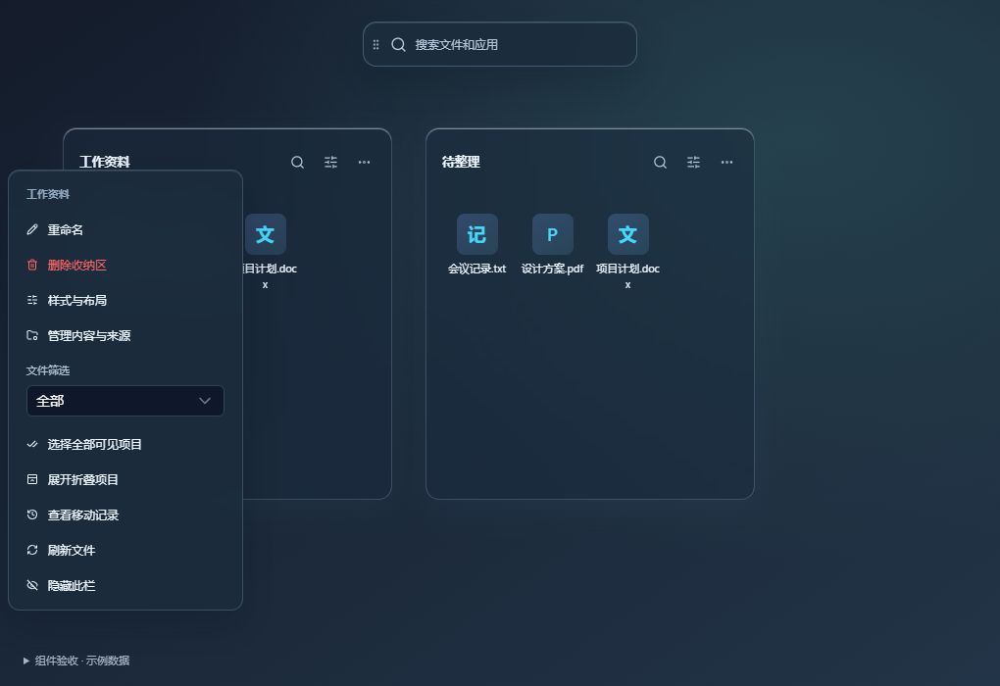

# 桌面操作调整 · 2026-10-05

## 使用方式

- 拖动和缩放收纳区时，整个面板留在显示器范围内。多屏可以跨屏拖动，显示器之间的空隙也不会留下不可见的面板；旧的越界位置启动时自动恢复。
- 双击收纳区标题即可改名，回车保存、Esc 取消。也可以右键标题或点击「更多操作」选择重命名或删除。目录改名复用既有迁移逻辑。
- 删除收纳区先确认，再将文件放回桌面；文件返回失败时保留收纳区和布局。删除标签组则恢复各个收纳区独立显示。
- 原顶部工具条换成独立的「搜索文件和应用」组件。拖动左侧握柄调整位置，点击打开现有搜索窗口。位置使用已有布局集合持久化，继续参与跨窗口三方合并。
- 管理器「小组件」中可以隐藏、恢复及定位搜索组件。新建收纳区和管理入口仍可通过系统托盘访问。
- 普通单选只高亮图标，选中两项及以上才出现批量操作栏。批量栏浮在面板底部，不再挤动图标，避免切回双击打开时点错位置。
- 标题栏上下留白收紧：最小高度从 62px 改为 40px，上下内边距均为 6px，内容区顶部内边距从 8px 改为 2px。移除产品主题重复覆盖的标题栏内边距，避免基础样式失效。

## 验证

- `node --test tests/*.test.mjs`：82 项通过。覆盖四边拖动、八方向缩放、跨屏/屏幕空隙、锁定、旧布局恢复、紧凑搜索高度、删除顺序/取消/失败保留。
- `pnpm build`：类型检查和生产构建通过。
- 浏览器使用生产组件与内存 IPC 验收：双击改名自动聚焦和全选；回车保存同步示例目录；Esc 取消；标题右键入口；删除取消/确认及示例文件返回桌面；搜索调用；收纳区右下角边界；搜索组件左下角边界。无实际文件操作。
- 管理器组件页面验收：搜索隐藏后出现「恢复显示」，恢复和定位入口可用，控制台无错误。
- 单选/多选补充验收：单选批量栏数量为 0；Ctrl 多选两项显示批量栏；切换前后图标纵坐标均为 207px；多选后双击打开另一个项目，模拟打开调用恰好一次且批量栏消失。
- 间距调整验收：浏览器计算样式确认两栏标题栏实际高度均为 40px、上下内边距均为 6px；双击标题仍可进入重命名，点击取消后恢复。
- 未修改 Rust。本次没有在真实桌面窗口验证 Windows 输入焦点、多屏硬件和文件移动；相关原生路径复用现有实现。
- Windows 发布构建生成便携程序及 NSIS 安装包。

