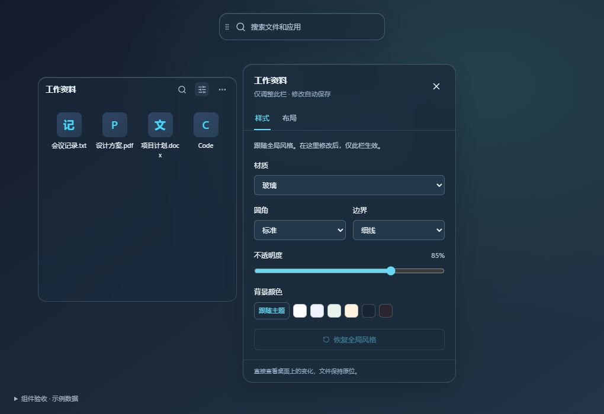

# 桌面绘制和交互修复 · 2026-10-05

## 修复

- **编辑时所有栏像被选中**：样式数据原本按布局键隔离，未发生全局覆盖。桌面窗口平时裁剪在表面矩形内，打开全屏菜单会露出所有面板的外部阴影。桌面面板改为边界内的高光和阴影，菜单开关前后绘制一致；编辑按钮只标记当前栏。管理器预览保留外部阴影。
- **Windows 标题栏残影**：桌面层清除 caption、系统菜单和窗口边框标志；两种 `WM_NCCALCSIZE` 均不预留非客户区域，禁止 `WM_NCPAINT`，激活消息继续交给 Tao 处理但以 `lParam=-1` 禁止原生边框重绘。保留 NOACTIVATE、WebView 子窗口输入挂接和原生文件拖放。
- **弹窗关闭时整层闪动**：前端规范化、裁剪和去重命中区域，合并被弹窗遮罩包含的子矩形；串行发送最新区域，成功确认后跳过重复 IPC，失败仍可重试。Rust 比较实际区域并跳过等价更新；更换区域不擦除整层，只无背景擦除地更新新露出的区域。归还键盘焦点不再重复激活本来已在前台的窗口。
- **附加修复**：单栏设置加入透明的原生命中遮罩，桌面空白点击能关闭；搜索的中文输入法候选阶段不再响应 Enter、Escape 和方向键。

## 验证

- `pnpm build`：类型检查和生产构建通过。
- `cargo check`：通过；`cargo test --lib`：21 项通过，包括无边框样式、原生区域等价、桌面空白穿透和文件操作保护。
- 前端行为测试：95 项通过。新增命中区域排序去重、遮罩包含、越界裁剪、失败重试、慢 IPC 顺序、相同区域排空期间的更新，以及搜索输入法测试。
- 真实 Vue 组件 + 内存 IPC：打开单栏设置后两栏样式变量与阴影均未变化，按钮展开状态为 `[true,false]`；第一栏圆角改为 2px，第二栏仍为 14px；恢复全局样式、关闭按钮、空白关闭通过。
- 栏内关键词「设计」只保留当前栏匹配文件；全局关键词「设计」返回两个来源的匹配文件，Escape 关闭通过。
- 单击 Code 示例只产生一次启动调用，裁剪同步计数保持 `9→9`；菜单开关、重命名输入及 Escape 取消通过。
- 600×420 视口下设置面板范围为 `(12,12)–(372,408)`，内容可滚动。
- 待办组件补查：第二个清单连续录入「检查桌面弹窗」后输入框清空并保持焦点；完成后移入折叠的已完成区域，可展开查看；第一个清单未发生修改。
- 原生 Windows 验收构建使用独立实例锁和 `releases/native-ui-test/state.json` 示例配置。与旧版同时显示时，旧版仍出现白色原生标题条，新版两栏未出现。未复制真实配置，未移动、删除或改名用户文件。
- **验证限制**：桌面被用户正在使用的其他窗口遮挡，未抢占或最小化这些窗口，因此原生桌面完整的弹窗打开/关闭、键盘借焦点循环和瞬时闪烁未完成实测。上述重绘路径修复需要在实际桌面继续确认；浏览器内存 IPC 不替代原生焦点与合成器验证。

## 原生验收构建

`ui-test` 功能仅供验收：独立实例锁、独立配置文件，桌面层在任务栏可发现；正式发布不启用它。可设置 `TAURI_CONFIG` 指定开发 URL 与 `app.nestra.ui-test` 标识，然后在 `src-tauri` 下执行 `cargo build --features ui-test`。

实现参考：[SetWindowRgn](https://learn.microsoft.com/en-us/windows/win32/api/winuser/nf-winuser-setwindowrgn)、[WM_NCACTIVATE](https://learn.microsoft.com/en-us/windows/win32/winmsg/wm-ncactivate)、[RedrawWindow](https://learn.microsoft.com/en-us/windows/win32/api/winuser/nf-winuser-redrawwindow)。

