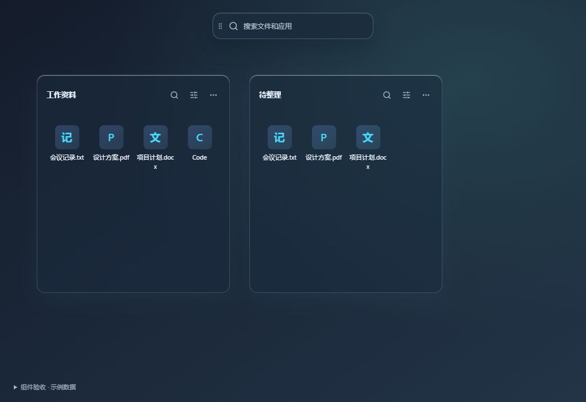

# 收纳区单击启动 · 2026-10-05

- 快捷启动默认隐藏。旧布局在初始化时隐藏一次，以 `PanelLayout.launcherVisibilityMigrated` 标记；标记随已有布局集合持久化和三方合并。之后用户显式恢复显示会保留，不会每次启动强制隐藏。
- 收藏入口和文件保持原位，管理器仍能恢复快捷启动。
- 收纳区内 `isApplication` 条目（扫描器识别的快捷方式、应用入口、可执行文件等）正常单击立即启动。使用现有 `launchEntry`，快捷方式仍交给 Windows 启动，以保留参数和工作目录。
- Ctrl、Shift、Meta 点击执行选择；拖动沿用既有点击抑制。连续双击的第二次 click 和 dblclick 不重复启动；未结束的启动调用也不会重复派发。
- 普通文件/文件夹仍采用单击选择、双击打开。

## 验证

- `node --test tests/*.test.mjs`：88 项通过，新增应用单击、双击防重复、修饰键选择、普通文件行为、首次隐藏及升级后显式恢复测试。
- `pnpm build`：类型检查和生产构建通过。
- 真实 Vue 组件 + 内存 IPC：单击 Code 示例产生 1 次打开调用；双击后累计 2 次，Ctrl 多选和拖动后仍为 2 次。没有调用真实应用或移动真实文件。
- 未改 Rust；原生发布构建生成最新程序与安装包。未验证实际 Windows 应用获取前台焦点。

