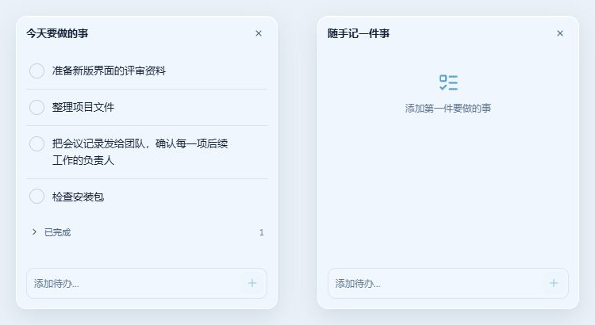
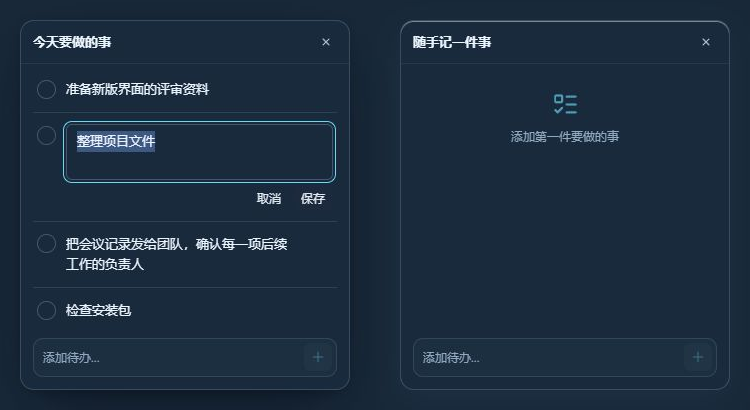

# 待办重设计（2026-10-05）

为桌面上快速记录和处理任务的人设计。主要操作直接在待办组件完成，控制中心复用同一个 `TodoList`，旧待办无需迁移。

## 交互

```text
今天要做的事                      ×
 ○ 准备评审资料
 ○ 整理项目文件
 > 已完成                         2

 [添加待办…                      +]
```

- 底部输入框固定显示；按钮或 Enter 添加，添加后清空输入并保持焦点，可以连续录入。
- 点击任务文字编辑；Enter 保存、Shift+Enter 换行、Escape 取消，也有明确的保存与取消按钮。中文输入组合期间忽略提交快捷键。
- 未完成任务优先显示；已完成任务默认折叠，展开后可以取消完成。长文字自然换行。
- 删除后提供撤销，恢复原来的内容、完成状态和位置。撤销保存最近一次删除，保留到关闭提示、再次删除或离开该组件；关闭应用后不保留撤销记录。
- 列表内部滚动且不显示滚动条；底部添加入口保持可见。小窗口和长清单也可以添加任务。
- 隐藏整个待办继续使用原来的隐藏功能，内容保留；组件名称仍可直接编辑。

## 视觉选择

沿用已确认的银白玻璃和深色玻璃主题：正文 `#142238`、辅助文字 `#516780`、交互强调 `#087baf`、浅色表面 `#f7fbff`；深色正文 `#edf5ff`、表面 `#24384b`。使用现有 Windows 系统字体，名称 13px/600，任务 13px/1.6，辅助操作 11–12px。

主要识别元素是左侧圆形勾选控件；分隔线、已完成折叠入口和固定添加框都服务于任务操作。复用 Nuxt UI 的 Checkbox、Input、Textarea、Button 和 Icon，没有新造基础控件或增加常驻工具栏。





## 保存与并发

所有任务修改仍通过 `touchWidget` → `scheduleSave` → 串行持久化链完成。现有 `todos` 数据结构保持不变，没有新的持久化集合字段。

同一待办组件的任务集合增加按任务 ID 的三方合并：不同任务的编辑、两边的新增都保留；单边删除得到尊重；同一任务发生冲突时远端胜。删除整个组件不会被任务合并复活。撤销生成新任务 ID，避免旧删除再次吞掉明确恢复的任务。

编辑期间检测另一窗口对同一任务文本的更新，保留当前草稿并显示冲突提示，避免直接覆盖远端内容。桌面文字输入继续由原有 `DesktopLayer` 的 focusin/focusout 逻辑授予和释放键盘焦点。

## 验证

实际生产组件在浏览器中验收，使用内存 IPC 和示例任务，不接触真实文件或用户配置。

| 场景 | 结果 |
| --- | --- |
| 空列表、按钮添加、Enter 连续添加、焦点保留 | 通过 |
| 点击编辑、自动选中文字、多行保存、取消编辑 | 通过 |
| 空内容不能保存、远端编辑冲突拦截 | 通过 |
| 完成、展开已完成、取消完成 | 通过 |
| 删除与撤销恢复 | 通过 |
| 220×150 历史最小组件、长清单、添加入口可用 | 通过 |
| 浅色、深色、长文字布局 | 已截图核对 |
| 控制中心编辑器使用同一组件并添加任务 | 通过，无控制台警告或错误 |
| 同一组件两窗口独立修改/新增、删除、冲突、组件删除 | 3 项新增回归测试通过 |
| 全部前端逻辑测试 | 74 项通过 |
| `pnpm build` | 通过，保留已有 bundle 大小警告 |

本次浏览器验收没有替代实际 Windows 桌面输入验证；原有原生焦点与窗口代码未改动。没有模拟提醒、日期调度或跨设备同步功能。

## 发布

本版在 `releases/todo-redesign-20261005/` 提供 x64 NSIS 安装包、免安装 ZIP 及 SHA256 校验文件。沿用 0.1.0 版本号和原有应用标识，继续读取已有配置。
